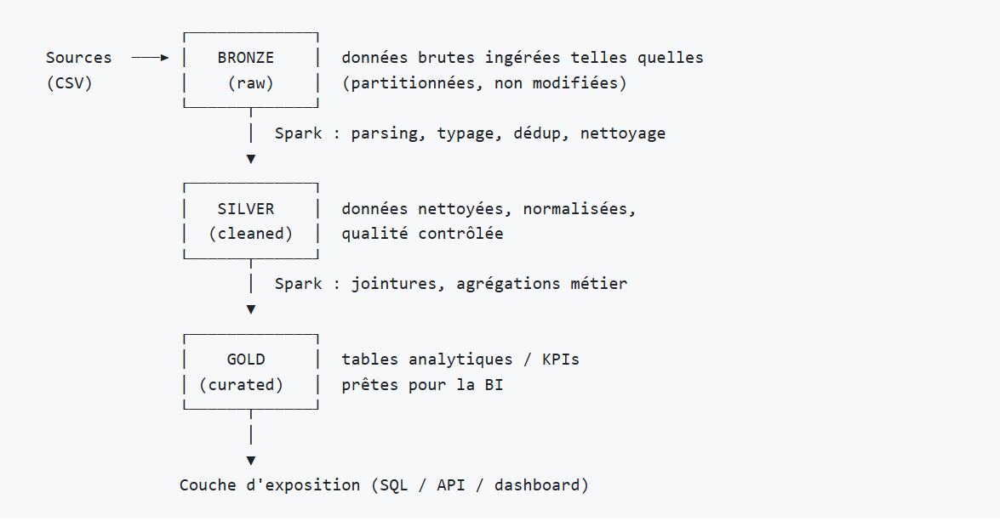

# Pipeline Chicago Taxi Datalake Bronze/Silver/Gold

## 1. Contexte

Ce dépôt contient un pipeline de données complet, pensé pour une entreprise de mobilité fictive. Il fait trois choses :

1. il va chercher les données brutes de trajets de taxi à Chicago (via l'API publique de la ville) et les dépose dans un data lake, en couche Bronze ;
2. il nettoie et transforme ces données pour produire des tables exploitables, en couche Silver ;
3. il calcule quelques agrégats utiles pour une équipe BI — revenus par jour, durée moyenne des trajets, zones de prise en charge les plus actives — en couche Gold.

L'orchestration est assurée par Apache Airflow, le traitement par Spark (PySpark), et l'ensemble tourne en local avec Docker Compose, en une seule commande.

---

## 2. Prérequis et lancement

### Ce qu'il faut avant de commencer

- Docker Desktop installé (Docker Compose v2 est inclus avec)
- Environ 6 Go de RAM disponibles pour Docker — Airflow, Spark, Postgres et MinIO/Silo tournent en même temps
- Une connexion internet, au moins pour le premier lancement (téléchargement des images et appel à l'API de la ville de Chicago)

### Démarrer le projet

```bash
# 1. Cloner votre fork du dépôt
git clone <url-de-votre-fork>
cd test_technique_data_engineer_ma

# 2. Construire les images et démarrer tous les services
docker compose up -d --build

# 3. Vérifier que tout tourne 
docker compose ps
```

### Accéder aux interfaces

| Service | Adresse | Identifiants |
|---|---|---|
| Airflow (orchestration) | http://localhost:8085 | `admin` / `admin` |
| MinIO/Silo (stockage objet, le data lake) | http://localhost:9001 | `minio` / `minio123` |
| Spark Master UI | http://localhost:8081 | — |

### Lancer le pipeline

**Depuis l'interface Airflow (le plus simple) :**
1. Ouvrir http://localhost:8085
2. Activer le DAG `taxi_pipeline` 
3. Cliquer sur ▶ "Trigger DAG"
4. Suivre l'avancement des trois tâches dans la vue **Grid** : `ingest_raw` → `bronze_to_silver` → `silver_to_gold`

**Ou en ligne de commande :**
```bash
docker compose exec airflow-webserver airflow dags trigger taxi_pipeline
```


### Vérifier que ça a marché

Dans la console MinIO/Silo (http://localhost:9001), le bucket `datalake` doit contenir :
- `bronze/taxi_trips/` — les fichiers CSV bruts, tels que reçus de l'API
- `silver/taxi_trips/` — les données nettoyées, en Parquet, partitionnées par `pickup_community_area`
- `gold/revenue_by_day/`, `gold/avg_duration/`, `gold/top_pickup_zones/` — les trois tables d'agrégats, en Parquet

Chaque dossier Silver et Gold contient aussi un fichier `_SUCCESS`, qui est simplement le marqueur standard que Spark dépose pour confirmer qu'une écriture s'est terminée sans erreur.

---

## 3. Architecture:

### La logique en couches (médaillon)

```
 Sources   ------->  | BRONZE   |  donnees brutes, telles que recues
 (API SODA)          | (raw)    |  (non modifiees)
                      -----------
                          |  Spark : parsing, typage, dedoublonnage, nettoyage
                          v
                      | SILVER   |  donnees nettoyees et normalisees,
                      | (cleaned)|  qualite controlee
                      -----------
                          |  Spark : agregations metier
                          v
                      | GOLD     |  tables analytiques, pretes
                      | (curated)|  pour la BI
                      -----------
                          |
                          v
            Couche d'exposition (fichiers Parquet / SQL / dashboard)
```



### Les briques de la stack

| Composant | À quoi il sert                                                                                                     | Pourquoi ce choix                                                               |
|---|--------------------------------------------------------------------------------------------------------------------|---------------------------------------------------------------------------------|
| Docker Compose | Fait tourner tous les services en local, en une commande                                                           | C'est  ce qui rend le projet reproductible chez n'importe qui                   |
| MinIO (fork **Silo**) | Stockage objet compatible S3, le socle du data lake                                                                | Simule un vrai stockage objet (S3) en local                                     |
| Apache Airflow | Orchestre et enchaîne les étapes du pipeline                                                                       | C'est l'outil standard pour ça                                                  |
| PySpark | Moteur de traitement : nettoyage, transformation, agrégation                                                       | Pensé pour passer à l'échelle sur de gros volumes                               |
| PostgreSQL | Stocke les métadonnées d'Airflow (définition des DAGs, historique des runs) / aucune donnée métier ne passe par là | Requis par Airflow pour fonctionner                                             |
| Parquet | Format de stockage des couches Silver et Gold                                                                      | Colonne, compressé, typé / le standard des data lakes, que Spark lit nativement |

## ==> Choix techniques 

Cette section détaille les décisions prises pendant le développement.

**MinIO → fork Silo.** L'image Docker officielle `minio/minio` a été retirée de l'accès gratuit en septembre 2026, d'abord sur Docker Hub puis sur Quay.io , ce qui cassait net tous les `docker compose up` qui en dépendaient, y compris le mien au départ. J'ai donc basculé sur **Silo** (`docker.io/pgsty/silo`), un fork communautaire entièrement compatible (mêmes variables d'environnement, mêmes ports, même API S3) qui continue de publier des images accessibles librement.

**Pagination par curseur plutôt que par offset.** Au départ, je paginais l'API SODA avec `$offset`. Ça fonctionnait, mais ça ralentissait énormément au fil des pages, jusqu'à finir en timeout,  l'API devient plus lente à mesure que l'offset grandit, c'est un comportement connu de ce genre d'API. J'ai basculé sur une pagination par curseur, sur `trip_start_timestamp` (`WHERE trip_start_timestamp >= dernier_timestamp_vu`), nettement plus stable sur ce type de dataset, avec des tentatives automatiques en cas de coupure réseau ponctuelle.

**Un DAG unique et linéaire.** Choix de simplicité et de lisibilité, vu le temps disponible (voir la section Architecture pour le détail).


### Le DAG Airflow

Un seul DAG, `taxi_pipeline`, séquentiel, avec trois tâches :

```
ingest_raw  >>  bronze_to_silver  >>  silver_to_gold
```

- **`ingest_raw`** appelle directement le script Python d'ingestion, qui écrit dans `bronze/`.
- **`bronze_to_silver`** et **`silver_to_gold`** lancent `spark-submit` à l'intérieur du conteneur `spark-master` (qui a déjà Spark et Java installés), via le socket Docker partagé, plutôt que de réinstaller Spark dans l'image Airflow. 

J'ai gardé un seul DAG linéaire pour que ce soit lisible rapidement, vu le temps imparti.
Sur un projet plus avancé, je découperais plutôt l'ingestion, la transformation et l'exposition en DAGs séparés, déclenchés les uns après les autres via des *Datasets* Airflow.

---

## 4. Les données : source et période choisies

- **Source** : le dataset public [Chicago Taxi Trips](https://data.cityofchicago.org/Transportation/Taxi-Trips-2013-2023-/wrvz-psew), récupéré via l'API SODA (`https://data.cityofchicago.org/resource/wrvz-psew.json`).
- **Période retenue** : le premier trimestre 2023 (du `2023-01-01` au `2023-03-31`), soit plusieurs centaines de milliers de lignes. C'est un volume suffisant pour avoir des résultats parlants, tout en restant raisonnable à faire tourner en local.
- **Script de téléchargement** : [`ingestion/fetch_taxi_data.py`](ingestion/fetch_taxi_data.py), lancé automatiquement par la tâche `ingest_raw`. Il récupère les données par pages de 50 000 lignes, en paginant par curseur sur `trip_start_timestamp` (voir plus bas pourquoi ce choix plutôt qu'une pagination classique par offset), et écrit chaque page en CSV dans `bronze/taxi_trips/`.
- **Reproductibilité** : la période (`START`/`END`) se change en tête de fichier. Relancer le DAG régénère les mêmes données : les fichiers bronze sont réécrits avec les mêmes noms, pas de doublons qui s'accumulent.

---


## 5. Ce que je ferais avec plus de temps

- Ajouter des **tests automatisés** sur les transformations PySpark elles-mêmes (schémas attendus, valeurs limites, gestion des nulls),j'ai couvert la partie ingestion avec `pytest`, mais pas encore les jobs Spark.
- Pousser la **qualité des données** en couche Silver, par exemple avec Great Expectations : bornes de validité sur `trip_total` et `trip_miles`, cohérence entre les timestamps de début et de fin de trajet.
- Mettre en place une **CI/CD** (GitHub Actions) : lint et tests à chaque push, build de l'image Docker en continu.
- Affiner le **partitionnement** (par zone et par date) et dimensionner réellement le cluster Spark ,plusieurs workers, un exécuteur Airflow Celery ou Kubernetes plutôt que LocalExecutor pour un vrai passage à l'échelle.
- Construire une **vraie couche d'exposition BI** : une API légère (FastAPI) ou un connecteur direct vers un outil comme Metabase ou Superset branché sur les tables Gold, plutôt que des fichiers Parquet à requêter manuellement.
- Gérer les **secrets et la configuration** via des variables d'environnement ou des Airflow Connections plutôt qu'en dur dans le code {acceptable ici vu qu'on est dans un environnement 100% local et jetable, mais pas une pratique à garder en production}.
- **Découpler les DAGs** : séparer ingestion, transformation et exposition en DAGs indépendants, déclenchés via des *Datasets* Airflow, plutôt qu'un seul DAG séquentiel.
